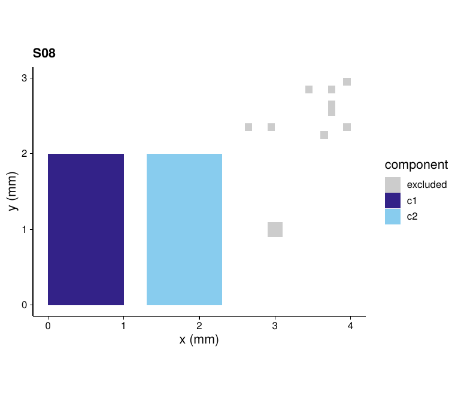
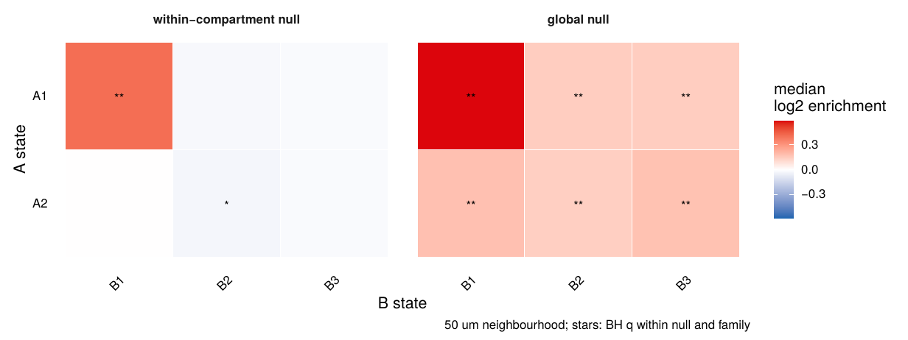
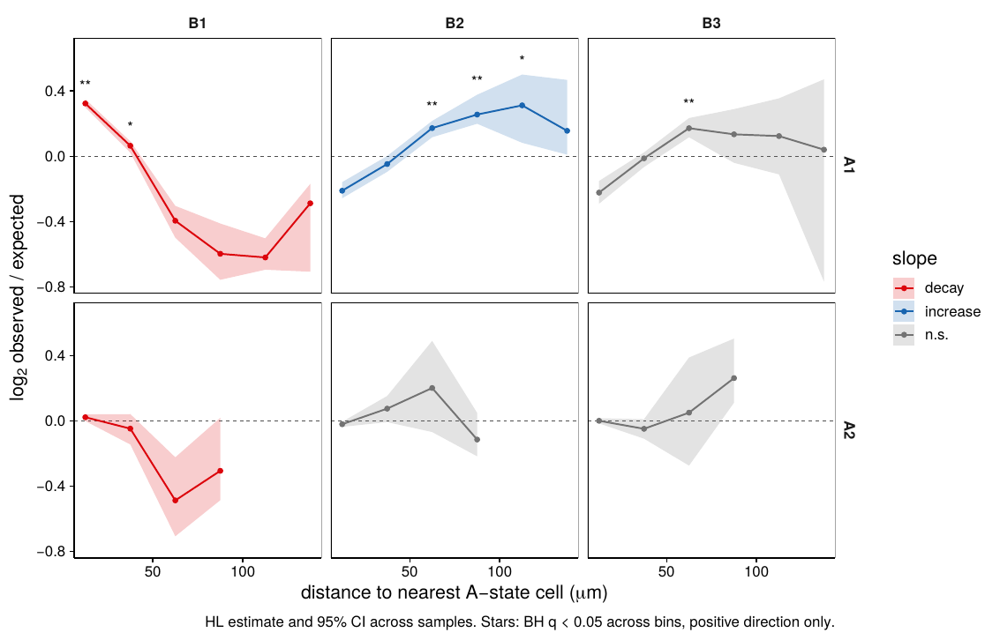
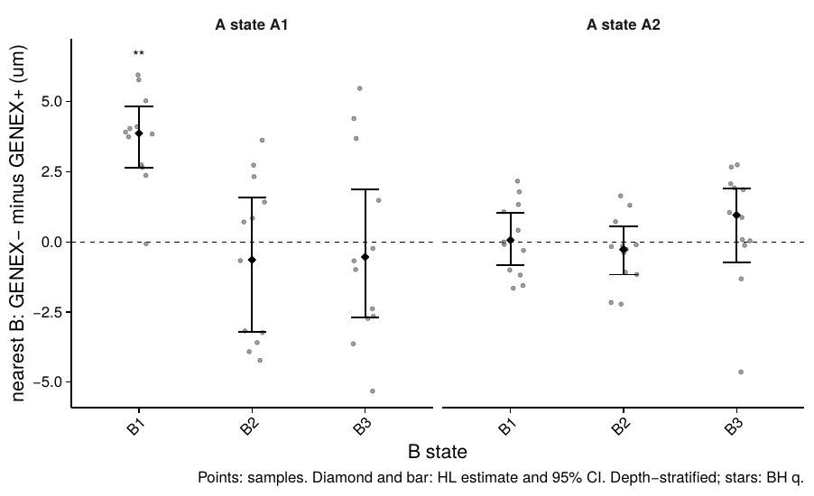
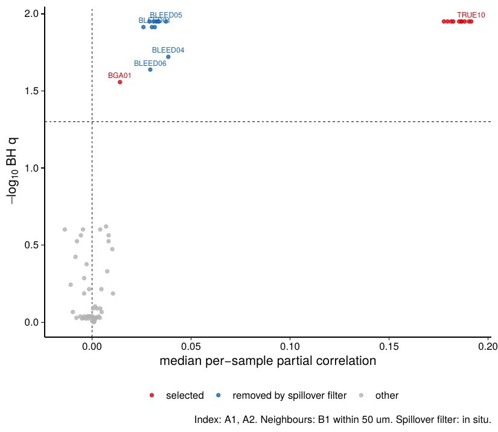

# xenium-spatial-niche

Tests whether labelled cell populations are found in each other's local
neighbourhoods more often than tissue architecture alone would predict, 
using the section (sample) as the unit of inference. The toolkit was developed on 10x
Genomics Xenium data, but the analyses require only cell centroids in
micrometres, a cell label and, for two modules, a counts matrix. It
therefore applies equally to CosMx, MERSCOPE and other single-cell-resolution
spatial platforms once the data are formatted according to the standard input described below

## Purpose

In most tumour sections, any two stromal populations appear close to each
other simply because both occupy the stroma. Pairwise permutation tests that 
shuffle labels across an entire section can therefore detect broad co-localisation 
driven by tissue architecture rather than a specific cellular niche. This toolkit asks 
a more specific question: given where a cell compartment already sits, is a particular 
state in one compartment preferentially located near a particular state in another?  
It answers five related questions about a reference compartment A and a target compartment B:

1. **Geometry.** Is each section one contiguous piece of tissue, and at what
   spatial scale are its cells packed?
2. **Co-localisation.** Which B states are adjacent to which A states more
   often than expected, given where each compartment sits?
3. **Distance decay.** Over what range does that enrichment persist, and is
   it a gradient or a step?
4. **Exposure contrast.** Among A cells, are B cells closer to, or more
   numerous around, those that express a gene g than those that do not, at
   matched sequencing depth?
5. **Neighbourhood-associated genes.** Which genes are detected more often in
   index cells that have more neighbour cells around them, after depth,
   crowding and segmentation spillover are taken into account?

## Design principles

- **The sample is the replicate unit.** Every statistic is computed within a
  sample; cohort inference is a Wilcoxon signed-rank test across samples,
  with the Hodges-Lehmann estimate and its 95% confidence interval. 
- **Permutation within connected tissue components.** Components are found on
  a binned occupancy grid (module 01); small components are treated as debris
  and excluded. Labels never move between disconnected pieces of a section.
- **Compartment-specific nulls.** Co-localisation shuffles A labels among A
  cells and B labels among B cells. Distance decay shuffles B labels among B
  cells. A global null, shuffling all labels, is also reported so the contribution of tissue
  architecture is visible.
- **Depth is controlled on the exposure.** In module 04, gene
  detection depends on the focal cell's own depth, so focal cells are
  stratified by depth.
- **Pre-specified pairs form their own multiple-testing family.** Pairs named
  in `PRIMARY_PAIRS` before the analysis are corrected separately from the
  exploratory remainder.
- **Unlabelled cells** occupy space but are never shuffled or counted.

## Method

**01 Geometry QC.** Cells are binned on a `BIN_UM` grid; a bin with at least
`MIN_CELLS_BIN` cells is considered tissue. Occupied bins are joined by rook (4) or
queen (8) adjacency, and components smaller than `MIN_REGION_BINS` bins are considered
debris (component 0). The module also reports cell density, the median nearest-neighbour
distance and median depth, which are the reference values for the
thresholds of the other modules.

**02 Co-localisation.** Per sample, a fixed-radius (`RADIUS_UM`) neighbour
graph is built over labelled in-tissue cells. For each A state x B state
pair, the number of edges joining the pair is compared with its permutation
distribution, giving log2((observed + 1) / (expected + 1)), a z-score and a
two-sided empirical p. The graph is built once so each permutation only
relabels nodes.

**03 Distance decay.** For every labelled cell, the distance to the nearest
cell of A state a is binned (`BIN_WIDTH_UM`, censored at `MAX_D_UM`). Per bin,
the observed number of cells of each B state is compared with its
expectation under the B-label shuffle. Three cohort statistics are reported:
a per-bin test, a per-sample decay slope (test of whether the
association decays), and the distance at which enrichment crosses zero.

**04 Exposure contrast.** Focal cells are the cells of an A state, split by
detection of `EXPOSURE_GENE` (count > 0). The primary readout is the distance
from each focal cell to its nearest cell of a B state (gene-negative minus
gene-positive, so positive values mean B is closer to gene-positive cells);
the companion readout is the number of B cells within `RADIUS_UM`. Arm
differences are averaged within `N_DEPTH_STRATA` within-sample depth strata;
the unstratified difference is reported alongside.

**05 Neighbourhood-associated genes.** Per sample and gene, the partial
correlation between detection in index cells and log1p(number of neighbour
cells within `RADIUS_UM`) is computed, given log depth and local cell
density, for all genes at once by residualisation. Genes are selected on the
cohort median correlation, BH-corrected Wilcoxon test and consistency across
samples, and must pass a spillover filter: with a reference table of mean
expression per compartment (`SPILL_REFERENCE`), the gene must be at least
`SPILL_RATIO_MIN` times more expressed in the index compartment than in any
other; without one, its detection in index cells with no neighbour within
`RADIUS_UM` must be at least `SPILL_RATIO_MIN` times its detection in the
neighbour compartment. **A matched scRNA-seq reference is preferred** as reference.

## Requirements

- R (>= 4.3)
- CRAN: Matrix, igraph, dbscan, ggplot2, openxlsx
- Import from Xenium Ranger outputs: hdf5r (for `cell_feature_matrix.h5`);
  arrow is optional (to read `cells.parquet`; otherwise `cells.csv.gz` is
  read)
- Import from Seurat: SeuratObject (>= 5); Seurat itself is not needed

## Inputs

Modules 01-05 read only the standard input, which the two import scripts
write. Per sample, in `input/<sample_id>/`:

| File | Contents | Needed by |
|---|---|---|
| `cells.rds` | data.frame: `cell_id`, `x_um`, `y_um`, `label` (NA = unlabelled), `n_count` | 01-05 |
| `counts.rds` | dgCMatrix, genes x cells, raw counts, columns in `cells.rds` order | 04, 05 |

Once per run, in `input/`:

| File | Contents |
|---|---|
| `samples.csv` | `sample_id`, plus any sample-level covariates to carry into outputs |
| `label_map.csv` | `label`, `compartment` |

`label_map.csv` groups fine labels into broad compartments. Every
permutation shuffles labels only among cells of the same compartment and
tissue component. The import scripts write `label_map_template.csv` with every 
label found and an empty compartment column; it should be filled and saved as `label_map.csv`.

### From Xenium Ranger outputs

`00a_import_xenium_ranger.R` reads, for each sample folder in `XR_DIRS`,
`cells.parquet` (or `cells.csv.gz`) for centroids and `transcript_counts`,
and `cell_feature_matrix.h5` (or the `cell_feature_matrix/` folder) for
counts, keeping only features of type `Gene Expression`. Labels come from a
CSV (`cell_id`, `label`, and `sample_id` if one file covers all samples) set
in `XR_LABELS`. Cells absent from the label file are unlabelled.

### From a Seurat object

`00b_import_seurat.R` reads a saved Seurat v5 object holding one or several
samples, with centroids in its fields of view (as created by `LoadXenium()`).
Label, sample and (optionally) count columns of `meta.data` can be set in the
configuration. Merged objects are supported: each sample's field of view is
matched to the sample column by cell name, and count layers split by
`merge()` are joined.

`COORD_SCALE`, the number of micrometres per coordinate unit, is required.
**To obtain it:** objects built with `LoadXenium()` store centroids in
micrometres, so `COORD_SCALE <- 1`. For any other object, run the import and 
check the reported section width, height, and median nearest-neighbour distance 
for each sample; these are also saved in `input/00_import_report.xlsx`). The width and
height should match the physical section size, and the nearest-neighbour distance
should be roughly a cell diameter (about 5-20 um in solid tissue).
A value in the hundreds or thousands means the coordinates are pixels: set
`COORD_SCALE` to the image pixel size in um per pixel (for Xenium morphology
images it is recorded as `pixel_size` in `experiment.xenium`).

## Configuration

All parameters are in `config.R`. Every script reads `config.R`, or the file
given as its first argument.

### Defining the comparison

Three settings define what is compared; every other parameter is a
threshold. For a fibroblast-macrophage niche:

```r
# input/label_map.csv assigns every label to a broad compartment, e.g.
#   label,compartment
#   fibro-prematrix,fibroblast
#   CAFs,fibroblast
#   mac-M2-CXCL,myeloid
#   mac-angio,myeloid
#   cancer-basal,tumour

COMP_A   <- "fibroblast"   # reference: the cells whose neighbourhood is examined
COMP_B   <- "myeloid"      # target: the cells counted around them
STATES_A <- NULL           # NULL = every fibroblast label; or a subset
STATES_B <- NULL           # NULL = every myeloid label
PRIMARY_PAIRS <- list(c("fibro-prematrix", "mac-M2-CXCL"))   # fixed before the run
```

- **`COMP_A` and `COMP_B`** name two different compartments. They set the
  null: the test asks which myeloid state, among myeloid cells, sits nearest
  which fibroblast state among fibroblasts. Co-localisation (02) is symmetric
  in A and B; distance decay (03) measures distances from A cells; the
  exposure contrast (04) uses A cells as focal cells.
- **`STATES_A` and `STATES_B`** are the fine labels tested. Each combination
  is one test, so restricting them reduces the number of tests.
- **`PRIMARY_PAIRS`** lists the pairs to be tested by the primary analysis.
  They are corrected for multiple testing as their own family; every other
  pair is exploratory. `list()` makes the whole run exploratory.
- Module 05 does not test state pairs; it uses `INDEX_STATES` and
  `NEIGHBOUR_STATES`, each a set of labels pooled into one group.

### Thresholds

**The defaults are the values used in the analysis this toolkit was built
from: one breast cancer cohort, Xenium 5,000-gene panel, median of about 180
transcripts per cell and 3,000-5,000 cells per mm2. They should be checked for 
each dataset against the density and depth figures reported by module 01.**

| Parameter | Default | Used by | Description |
|---|---|---|---|
| `INPUT_DIR`, `RESULTS_DIR`, `SAMPLES` | input, results, NULL | all | Folders; NULL = all samples |
| `BIN_UM` | 100 | all | Occupancy grid bin for tissue components (um) |
| `MIN_CELLS_BIN` | 5 | all | Cells for a bin to count as tissue |
| `CONNECTIVITY` | 4 | all | 4 (rook; splits diagonally touching pieces) or 8 (queen; joins them) |
| `MIN_REGION_BINS` | 10 | all | Components smaller than this are debris (10 bins = 0.1 mm2) |
| `MIN_STATE_CELLS` | 50 | 02-04 | Cells of a state in a sample for it to contribute |
| `MIN_SAMPLES` | 5 | 02-04 | Minimum number of samples for a cohort test |
| `RADIUS_UM` | 50 | 02, 04, 05 | Neighbourhood radius |
| `N_PERM_PRIMARY`, `N_PERM_GLOBAL` | 1000, 200 | 02 | Permutations, within-compartment and global null |
| `BIN_WIDTH_UM`, `MAX_D_UM` | 25, 200 | 03, 04 | Distance bins; distances beyond `MAX_D_UM` are censored |
| `N_PERM_DECAY` | 200 | 03 | Permutations for the expected curve |
| `MIN_BIN_B` | 20 | 03 | Compartment-B cells in a bin for a proportion |
| `MIN_BINS_FIT` | 3 | 03 | Bins for a per-sample decay slope |
| `STAR_DIRECTION` | positive | 03 | Hypothesised direction: positive, negative or both |
| `EXPOSURE_GENE` | (required for 04) | 04 | Gene whose detection splits focal A cells |
| `MIN_MEDIAN_DEPTH` | 100 | 04, 05 | Sample excluded if the median n_count of labelled cells is below this |
| `MIN_ARM` | 20 | 04 | Focal cells per arm (gene+ and gene-) per sample |
| `N_DEPTH_STRATA` | 10 | 04 | Number of within-sample depth strata |
| `INDEX_STATES`, `NEIGHBOUR_STATES` | (required for 05) | 05 | Labels pooled as index and neighbour cells |
| `MIN_INDEX_CELLS`, `MIN_NEIGHBOUR_CELLS` | 50, 50 | 05 | Per sample |
| `MIN_DETECT_FRAC` | 0.02 | 05 | Index-cell detection rate for a gene to be tested in a sample |
| `MIN_SAMPLES_GENE` | 10 | 05 | Samples in which a gene must be tested |
| `FDR_MAX`, `MIN_FRAC_POS`, `N_TOP` | 0.05, 2/3, 25 | 05 | Selection thresholds |
| `SPILL_REFERENCE`, `SPILL_RATIO_MIN` | NULL, 2 | 05 | Optional reference table; minimum specificity ratio |
| `SEED`, `BASE_SIZE` | 20260819, 14 | all | Random seed; figure base font size |
| `FORCE_REBUILD`, `REPLOT_ONLY` | FALSE, FALSE | 02-05 | Recompute despite a valid checkpoint; redraw from the checkpoint only |

## Running

From the repository root:

```
Rscript 00a_import_xenium_ranger.R       # or 00b_import_seurat.R
Rscript 01_geometry_qc.R
Rscript 02_colocalisation.R
Rscript 03_distance_decay.R
Rscript 04_exposure_contrast.R            # needs EXPOSURE_GENE
Rscript 05_neighbourhood_genes.R          # needs INDEX_STATES, NEIGHBOUR_STATES
```

Each script can take an alternative configuration file as its first argument. 
Module 01 must be run first; modules 02–05 can then be run independently. These 
modules save per-sample results and their calculation parameters in `cache/`. 
A checkpoint is reused only if both those parameters and the tissue components 
generated by module 01 remain unchanged. As a result, cohort-level statistics 
and figures can be regenerated without recomputation by setting `REPLOT_ONLY <- TRUE`.

## Outputs

Each module writes to `RESULTS_DIR/<module>/` an unformatted Excel workbook,
PDF figures and `session_info.txt`.

| Module | Workbook sheets | Figures |
|---|---|---|
| 01 | `per_sample`, `per_component`, `depth_by_label`, `sensitivity` | `01_tissue_maps.pdf`; also `components.rds`, read by 02-05 |
| 02 | `sample_info`, `per_sample`, `cohort_summary` | `02_heatmaps.pdf` (both nulls side by side), `02_per_sample.pdf` |
| 03 | `sample_info`, `per_sample_bin`, `bin_tests`, `slopes_per_sample`, `slope_tests`, `crossing` | `03_decay_all_pairs.pdf`, `03_decay_primary_pairs.pdf` |
| 04 | `sample_inclusion`, `distance_per_sample`, `distance_summary`, `count_per_sample`, `count_summary`, `state_diagnostics` | `04_effect_distance.pdf`, `04_effect_count.pdf`, `04_heatmap_distance.pdf`, `04_heatmap_count.pdf` |
| 05 | `sample_inclusion`, `per_sample_cor`, `gene_summary`, `selected_genes`, `spillover_removed`, `selection_funnel` | `05_gene_volcano.pdf`, `05_selected_heatmap.pdf` |

In every cohort table, `p_raw` is the Wilcoxon p, `q_BH` the
Benjamini-Hochberg q within its family (`pre-specified` or `exploratory`),
`estimate`, `ci_low` and `ci_high` the Hodges-Lehmann estimate and 95% CI,
and `n_samples` the number of contributing samples.

## Example and validation

`example/` contains a simulator and a validation script that runs every
module on simulated data with known truth:

```
Rscript example/simulate_example.R    # about 15 s
Rscript example/validate_example.R    # about 8 min
```

The simulation has two cohorts of 12 samples (2 x 2 mm, about 3,500 cells per
mm2, six tumour nests in a stroma). Compartments A (states A1, A2) and B (B1,
B2, B3) are both enriched in stroma, so the architecture alone makes every A
state appear close to every B state. Sequencing depth follows a smooth
spatial field. One sample has two separate pieces and debris.

- In the **planted** cohort, extra B1 cells are placed around A1 cells (more
  around A1 cells expressing gene `GENEX`); B3 is more frequent where depth
  is high, which creates a spurious association between `GENEX` detection in
  A2 cells and B3 proximity; ten genes respond to local B1 cells in A cells,
  and ten B-specific genes spill into adjacent A cells.
- The **null** cohort has the same architecture without any state-level
  structure.

The validation script checks 28 expected results and writes them to 
`example/validation_report.xlsx`. These include: recovery of the planted niche 
under the within-compartment null, with enrichment decreasing with distance; 
the global null flagging every pair in both cohorts; the depth artefact being 
significant without stratification but absent after stratification; selection 
of all true genes and no spillover genes under either filter; no findings in the 
null cohort; and both import scripts reproducing the standard input exactly from 
simulated Xenium Ranger folders and a merged Seurat object with pixel coordinates.

| Tissue components (sample with two pieces and debris) | Co-localisation, both nulls |
|---|---|
|  |  |

Distance decay. The planted A1 x B1 niche decays with distance; the B2 and
B3 rows rise because the readout is compositional (see Interpretation):



| Exposure contrast (distance, depth-stratified) | Neighbourhood-associated genes |
|---|---|
|  |  |

## Interpretation

- **Within-compartment versus global null.** A pair enriched under the global
  null but not under the within-compartment null reflects where the two
  compartments sit in contrast to a preference between states.
- **Compositional readouts.** In modules 02 and 03, enrichment of one B
  state near an A state forces relative depletion of the other B states
  there. In the example, B2 and B3 are depleted near A1 because B1 is
  enriched. `STAR_DIRECTION` therefore marks bins in the hypothesised
  direction only.
- **Module 04** compares gene-positive with gene-negative cells of the same
  state at matched depth. A positive result shows that proximity is greater
  around gene-positive cells.
- **Module 05** identifies associations with the neighbourhood. Selected genes 
  should be checked against the spillover columns of `gene_summary`.

## Limitations

- Results depend on the cell labels and on segmentation. 
- Samples where compartment A is abundant have a compressed distance range,
  so far distance bins in module 03 are supported by fewer samples; the
  number of samples per bin is reported.

## Citations

- dbscan: Hahsler M, Piekenbrock M, Doran D. dbscan: Fast density-based
  clustering with R. J Stat Softw 91, 1-30 (2019).
- igraph: Csardi G, Nepusz T. The igraph software package for complex network
  research. InterJournal Complex Systems 1695 (2006).
- SeuratObject / Seurat: Hao Y et al. Dictionary learning for integrative,
  multimodal and scalable single-cell analysis. Nat Biotechnol 42, 293-304
  (2024).
- Hodges-Lehmann estimator: Hodges JL, Lehmann EL. Estimates of location
  based on rank tests. Ann Math Stat 34, 598-611 (1963).

## Licence

MIT. See `LICENSE`.
